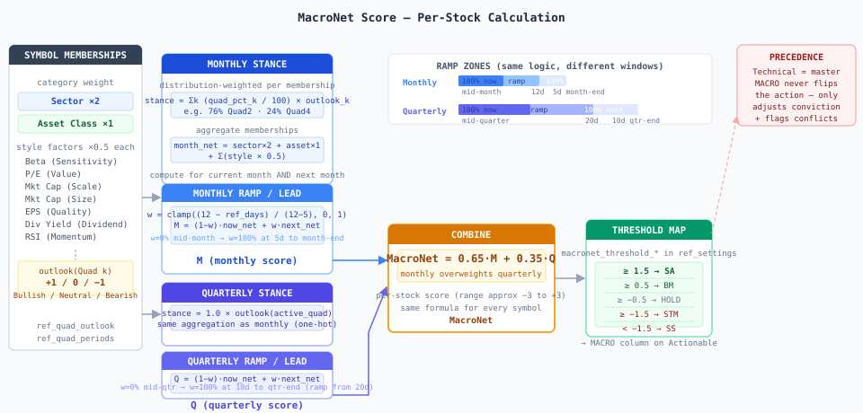

# Quad regime → MACRO — design

How the macro **quad regime** becomes a single **MACRO** signal per stock on the
Actionable screen. Authoritative design + implementation reference.

**Key tables:** `ref_quad_periods` (period distributions), `ref_quad_outlook`
(Bullish/Bearish/Neutral per category × quad), `drv_macro_score` (output).
**Deriver:** `etl/derive_macro.py` → wired into `derive_all()` after `drv_ma`.

---

## Principles

1. **Overlay, not standalone.** MACRO decides when to press a bottom-up call and
   when to back off — never a buy/sell on its own.
2. **Technical is master.** MACRO never flips the action; it adjusts conviction and
   flags conflicts. It may lean the call only when Technical is neutral/absent.
3. **One `MACRO` column** in SA/STM/HOLD/BS/BM vocabulary + `actionDisplay()` colors.
4. **One regime band** (window mix + quarter + favoring + breadth + action split) above the grid.
5. **Tag = score cut-offs only.** No override rule sits between the score and the tag.
6. All weights/windows/thresholds live in `ref_settings`.

Mental model (Hedgeye framing): the quarterly Quad is the climate, the monthly
Quad the weather, Shallow/Deep the intensity (= the per-quad % scores of each
month), and the Hedgeye signal / source pecking order (see
`docs/actionable_logic.md`) is what steers the final action. MACRO only
supplies the backdrop.

---

## Data model

**`ref_quad_periods`** — one row per month and one per quarter:

| Column | Monthly rows | Quarterly rows |
|---|---|---|
| `period_type` | `'monthly'` | `'quarterly'` (also `'global'` rows exist, unused here) |
| `year`, `period_num` | year, month 1-12 | year, quarter 1-4 |
| `quad` | declared quad (display fallback) | declared quad — the only quarterly input |
| `quad1_pct … quad4_pct` | per-quad scores (sum ≈ 100) — the Shallow/Deep intensity | NULL (one-hot implied) |

Seeded from `db/seeds_quad_periods.sql`. Monthly rows exist only from the seed
forward; earlier months are not kept.

**`ref_quad_outlook`** — `(category, sub_category)` × `quad1..quad4` =
Bullish / Neutral / Bearish. Categories: `Equity Sectors`, `Asset Class`,
`Equity Style`, `Fixed Income`. Lookups are case/whitespace-insensitive.

**`drv_macro_score`** — output (idempotent DELETE+INSERT per derive date):

| Column | Meaning |
|---|---|
| `monthly_score` | `M_window` (Stage 3) |
| `quarterly_score` | `Qtr` (current quarter, fading into next in its last month) |
| `qtr_now_net` / `qtr_next_net` / `qtr_weight` | current-quarter stance / next-quarter stance / fade weight of the next quarter (0 outside the last month) |
| `macronet`, `macro_action` | blended score and final tag |
| `quad1_net … quad4_net` | stance if that quad were 100% certain (Universe Q1-Q4 filter) |
| `sector_stance`, `asset_class_stance`, `style_stances` | per-membership stances (MACRO column dots) |
| `monthly_scores_json` | stance vs each individual month (sparkline) |
| `detail` JSONB | window breakdown for the tooltip (below) |

`month_now_net`, `month_next_net`, `month_weight` are deprecated: kept as
columns, always NULL.

---

## Pipeline



> The diagram predates the sliding window and the override removal — this
> document is authoritative.

---

## Stage 1–2 — per-stock membership net score

A symbol is a bundle of memberships `(category, sub_category, weight)`:

| Membership | Category | Weight | Source |
|---|---|---|---|
| Sector | `Equity Sectors` (or `Fixed Income` for bond/credit instruments) | **×2** | `drv_ma.sector` / `sub_asset_class` |
| Asset class | `Asset Class` | **×1** | `drv_ma.asset_class` |
| Style factors | `Equity Style` | **×0.5 each** | `_classify_style` |

Sector special cases (`etl/derive_macro.py`):

- Index/futures/FX symbols missing a sector are bridged via `ref_rrt` →
  `ref_sector` for asset class / sub-asset class only (the bridged sector is a
  placeholder and is ignored).
- Fixed Income instruments score against the `Fixed Income` outlook category
  using `sub_asset_class` (HY Credit, IG Credit, Long Bond, ...).
- `Country ETF`, `Gold`, `USD`, `Fixed Income`, `Fixed Income Volatility` get no
  sector membership (`_NO_SECTOR_MEMBERSHIP`). Gold/USD are still scored via
  `Asset Class`.
- Any other membership with no `ref_quad_outlook` row is reported once per run
  in `meta_warning` (missing-outlook warning).

**Style tags** (`_classify_style`):

| Tag | Condition |
|---|---|
| High Beta / Low Beta | `beta ≥ 1.5` / `beta ≤ 0.7` |
| Defensives | Consumer Staples, Health Care, Utilities, Real Estate |
| Cyclical | Industrials, Materials, Energy, Consumer Discretionary, Financials |
| Value / Secular | `0 < P/E < 15` / `P/E > 30` |
| Dividend | `div_yield > 2%` |
| Momentum | `RSI > 65` |
| Small / Mid Caps | `market_cap < $2B` / `$2B – $10B` (market cap 0 = no data, no tag) |

Stance of one membership against a quad distribution, then the symbol's net:

```
stance = Σ_k (quad_k_pct / 100) × outlook(quad_k)        Bullish +1 · Neutral 0 · Bearish −1
net    = sector×2 + asset_class×1 + Σ(style×0.5)
```

---

## Stage 3 — sliding look-ahead window

Each day a window `[D, D+H)` (`H = quad_lookahead_days`, default 60 calendar
days) is projected onto the monthly rows. Overlap-day fractions (optionally
decayed) give one normalized weight per month. Each month's stance comes from
Stage 1–2 against that month's own distribution.

```
w_m      = overlap_days(m, window) / H           (normalized, Σ w_m = 1)
M_window = Σ_m w_m × stance(m)
```

- **Decay** (optional, default off): `quad_lookahead_decay_hl` — half-life in
  days; `0` = flat window.
- **Coverage fallback**: if `ref_quad_periods` doesn't cover the whole window the
  window truncates to the months it has. Coverage < 50% → fall back to the
  current month alone and set `fallback: true`.
- Pure functions (`window_weights`, `near_far_split`, `tracking_tag`,
  `to_action`) are unit-tested in `tests/test_quad_window.py`.

**Worked example** (mid-July, H=60, no decay): window Jul 14 → Sep 12 =
July 18 days (30%), August 31 days (52%), September 12 days (18%). The weights
slide one day at a time.

**Quarterly leg (`Qtr`)**: one-hot stance of the current quarter's declared quad.
During the quarter's **last calendar month only** it fades linearly into the
next quarter's one-hot stance (day 1 = 0% next, last day = 100% next). Next
quarter is always loaded so the tooltip can show it, but contributes nothing
outside that month.

### Combine

```
MacroNet = (1 − q) × M_window + q × Qtr        q = quad_horizon_weight_qtr, default 0.05
```

The quarterly weight was cut 0.35 → 0.20 → 0.05 when the window replaced the old
month ramp. That was a design choice, not an outcome-tested one — see
§Evidence.

### `detail` JSONB (tooltip source)

```json
{"h": 60, "coverage_pct": 100, "fallback": false,
 "months": [{"m":"2026-08","quad":1,"w":0.52,"stance":2.1,"agrees":true}],
 "eff": {"q1":58,"q2":10,"q3":27,"q4":5},
 "near_vs_far": {"near":-1.2,"far":2.1,"override":"none"},
 "tracking": "2026-08 (Quad 1)",
 "tracking_conflict": false,
 "quarter_window": {"cur":{"label":"2026-Q3","quad":3,"w":1.0,"stance":-0.5},
                    "next":{"label":"2026-Q4","quad":2,"w":0.0,"stance":1.0},
                    "dtb": 75}}
```

- **near / far** — nearest month's stance vs the weight-averaged stance of the
  rest of the window. Informational (tooltip) only; `override` is always `"none"`.
- **tracking** — nearest window month whose stance sign matches the symbol's
  technical direction (`sign(last_price − sma_50)`); `null` = "fighting the quad path".
- **agrees** — per month, same comparison; `null` when there is no technical direction.
- **tracking_conflict** — technical direction disagrees with the sign of the final `macronet`.

---

## Stage 4 — score → tag

`MacroNet` maps to the action vocabulary by cut-offs in `ref_settings`
(`etl/derive_macro.py::to_action`; the API's `_macronet_to_vocab` mirrors it for
the legacy fallback path):

| Key | Value | Rule |
|---|---|---|
| `macro_thr_bm` | 1.25 | MacroNet ≥ → **BM** |
| `macro_thr_bs` | 1.05 | MacroNet ≥ → **BS** |
| `macro_thr_stm` | −0.6 | MacroNet ≤ → **STM** |
| `macro_thr_sa` | −1.0 | MacroNet ≤ → **SA** |
| otherwise | | **HOLD** |

Nothing else decides the tag. (Legacy `macronet_threshold_*` names are read as
a fallback only.)

### Change log

| Date | Change | Why |
|---|---|---|
| 2026-07-15 | Sliding window replaced month ramp; cut-offs recalibrated by percentile | TASK_126 |
| 2026-10-18 | **Near/far sign-agreement override removed** | Replay: final-tag edge was negative with it on in all 6 weight/window combinations, positive in 5 of 6 with it off; it also pushed ~36% of stocks to Buy |
| 2026-10-18 | **STM −0.15 → −0.6, SA −0.6 → −1.0** | Only scores below ≈ −1.0 lagged the market; −0.6…−0.15 was the wrong way (+0.55%) |
| 2026-10-18 | BM 1.25 and BS 1.05 left unchanged | No higher cut-off showed a better edge |

Resulting tag mix on 2026-10-16 (1,020 stocks): BM 228 · BS 49 · HOLD 666 ·
STM 62 · SA 15.

---

## Stage 5 — precedence: Technical is master

MACRO is an overlay — it never overrides the Technical action.

| Bottom-up ↓ \ Macro → | Bullish | Neutral | Bearish |
|---|---|---|---|
| **Buy** | PRESS LONG | Long | **CONFLICT — trim/skip** |
| **Neutral** | Watch-long | — | Watch-short |
| **Sell** | Dip — don't short | Short | PRESS short / exit |

The final action is decided by the source pecking order and Technical
(`docs/actionable_logic.md`), not by the Quad score.

---

## Stage 6 — presentation

- **MACRO column** (Actionable grid): `macro_action` badge + raw `macronet`
  (e.g. `BM 1.88`), rendered by `macroCellHtml()` in `web/actionable.js`;
  sortable via `data-key="macro_value"`. `macro_conf` = nearest window month's
  weight. `macro_turn` is retired.
- **Regime band** (`#macroBand`): window mix and dominant forward quad | quarter
  (de-emphasized) | favoring | breadth | action split. `loadMacroBand()`;
  data from `GET /api/quad-window`.
- **Tooltip**: `_macroTooltip()` / `_buildMacroPopHtml()`, lazy-loaded from
  `GET /api/actionable/macro-detail` (layers `drv_macro_score.detail` onto the
  live membership resolution): how-to directive, window table, category
  drivers, quarter, and the formula line.

---

## Evidence & known limits (2026-10-18 replay)

Replay of the full calculation on 49 days (2026-07-15 → 09-17), graded by the
20-day return vs the average stock. Replay of the stored tags matched 100%.

- **Near/far override** — hurt in every combination (see change log).
- **Quarterly weight (5% / 20% / 35%) and window (60 / 30 days)** — no clear
  winner. With the override off, a higher quarterly weight looked slightly
  better at 60 days (+0.24% → +0.49% total edge); no pattern at 30 days. Too
  little data to change the 5%.
- **Buy More cut-off** — edge was flat (≈ +0.3% to +0.7%) from 1.05 to 2.0 and
  faded in the second half of the window (+1.8% → +0.1% at 1.25). No cut-off
  was shown to be better, so 1.25 stays.
- **Buy More share is high** (22% of the list vs the original ~3% target):
  current scores are bunched high. Revisit as history builds.
- **Not covered**: ~49 overlapping days, one market direction, and monthly
  distributions before Sep 2026 are not stored — treat these as clues. Re-run
  when 2–3 months more history exists.
- The nightly factor scorecard (`v_factor_scorecard`, "Macro quad action") grades
  the current tags only; it cannot compare alternative weights.

Open question: no flag yet for quarterly-vs-monthly disagreement, and the
quarterly leg carries no intensity (declared quad only).

---

## Tunable params (`ref_settings`)

| Key | Default | Meaning |
|---|---|---|
| `quad_lookahead_days` | 60 | look-ahead window H, calendar days |
| `quad_lookahead_decay_hl` | 0 | within-window decay half-life; 0 = flat |
| `quad_horizon_weight_qtr` | 0.05 | quarterly weight `q` |
| `macro_thr_bm` / `macro_thr_bs` | 1.25 / 1.05 | Buy cut-offs |
| `macro_thr_stm` / `macro_thr_sa` | −0.6 / −1.0 | Sell cut-offs |

Retired (rows left in `ref_settings`, not read): `quad_month_ramp_begin_days`,
`quad_month_lead_days`, `quad_qtr_ramp_begin_days`, `quad_qtr_lead_days`,
`quad_horizon_weight_mo`.

After changing the window, quarterly weight or cut-offs, re-check the tag mix:
`SELECT macro_action, count(*) FROM drv_macro_score WHERE as_of_date = <anchor> GROUP BY 1`.

---

## Implementation files

| File | Role |
|---|---|
| `etl/derive_macro.py` | Per-symbol deriver; pure functions `window_weights`, `build_effective_distribution`, `near_far_split`, `tracking_tag`, `to_action`; writes `drv_macro_score` |
| `etl/derive.py::derive_all` | Runs the deriver after `drv_ma` |
| `db/baseline.sql` | `drv_macro_score` table and the `macro_thr_*` settings |
| `db/seeds_quad_periods.sql` | Monthly/quarterly quad distributions |
| `api/routers/dash.py` | Joins `drv_macro_score`; `GET /api/actionable/macro-detail`; `GET /api/quad-window`; `_macronet_to_vocab` (legacy fallback) |
| `web/actionable.js` | `macroCellHtml()`, `loadMacroBand()`, `_macroTooltip()` / `_buildMacroPopHtml()` |
| `tests/test_quad_window.py` | Unit tests for the pure functions |
| `docs/diagrams/macronet_formula.svg` | Pipeline picture (predates the window — not redrawn) |

---

## Market check — what the DATA says the Quad is (2026-10-19)

The sections above are the *calendar* view (the declared Quad). This is the *market-confirmation* view: two meters, **growth** and
**inflation** (each -100..+100), built from market factors, say which Quad prices are pointing to, independent of Hedgeye's declaration.
Design: `DESIGN_SPEC_8.md`; source note: Hedgeye Early Look 2026-10-19 ("Macro Grind": in Quad 2 Bitcoin and QQQ are long together, in
Quad 4 both get killed and bond yields break TRADE and TREND; commodities do not crash in Quad 2).

- **Quad from two arrows:** 1 = growth up / inflation down, 2 = up / up, 3 = down / up, 4 = down / down.
- **Factors** (`ref_quad_factor`, seeds `db/seeds_quad_factor.sql`): 14 rows in Hedgeye's three groups (risk & liquidity, inflation &
  commodities, growth/credit/cyclicals). Each reads up to three checks: 3-week move (~Hedgeye TRADE), 3-month move (~TREND) and the
  trend state (price vs `a_trend_value`, or the Hedgeye RR outlook). Up when 2+ checks agree up, down when 2+ agree down, else mixed;
  fewer than 2 checks = missing. Two straight closes through the risk range = breakdown (down). `weight` 0 = shown, does not vote
  (the dollar: Hedgeye is long USD *in* Quad 2). Every band and weight is a **guess**, tunable in the table.
- **Meters:** weighted share of up minus down, x100; under 60% weight coverage = "not enough data". +/-20 = clear (with / against).
- **Reference Quad** = the dashboard's 60-day Quad (`derive_risk_dial._dominant_quad`). **Transition risk** = the larger of the two
  meters' distance from agreeing with it (0-100): under 40 HOLDING, 40-59 WATCH, 60+ TRANSITION. **Leaning toward** = flip every meter
  that is not "with". **Market read** = one Quad when both meters are clear, two when one is unclear. The four **fit** bars (indicative,
  `quad_check_fit_scale`) give every Quad a share. A new label shows only after `quad_check_confirm_days` (2) derive dates.
- **Tables:** `drv_quad_factor` (one row per factor per date), `drv_quad_check` (one row per date). Idempotent per `as_of_date`.
  Derive: `etl/derive_quad_check.py`, run in `derive_all` after the EOD-source warning step. Stale inputs post one `meta_warning`
  (screen `dashboard`, code `QUAD_CHECK_STALE`).
- **Screen:** "Market reads" card under the three Quad cards (left column) with the four bars and a check/cross on each declared card;
  click = factor popover. `GET /api/cockpit/macro-week` carries `quad_check`; `GET /api/cockpit/quad-check` has the factors and history.
  Code: `web/macro_week.js` (`marketBlock`, `popHtml`).
- **Risk Dial:** gauge `quad_growth_break` (Quad 1/2 expected, growth meter <= -20 for 2 dates). Seeded **inactive** until the
  forward-return test is run. Also fixed `_g_quad2_overheat` to compare outlooks case-insensitively (`drv_rr.outlook` mixes
  BULLISH / Bullish).
- **Limits:** ~8 months of daily closes; the monthly-Quad reference only exists from 2026-09, so the 60-day version cannot be replayed
  yet. CRB is not tracked (equal-weight futures basket stands in); ISM/PMI are not loaded (copper vs gold, cyclicals vs defensives).
  Re-test when there are 6+ months of monthly Quad rows (about 2027-03). Tests: `tests/test_quad_check.py`.

